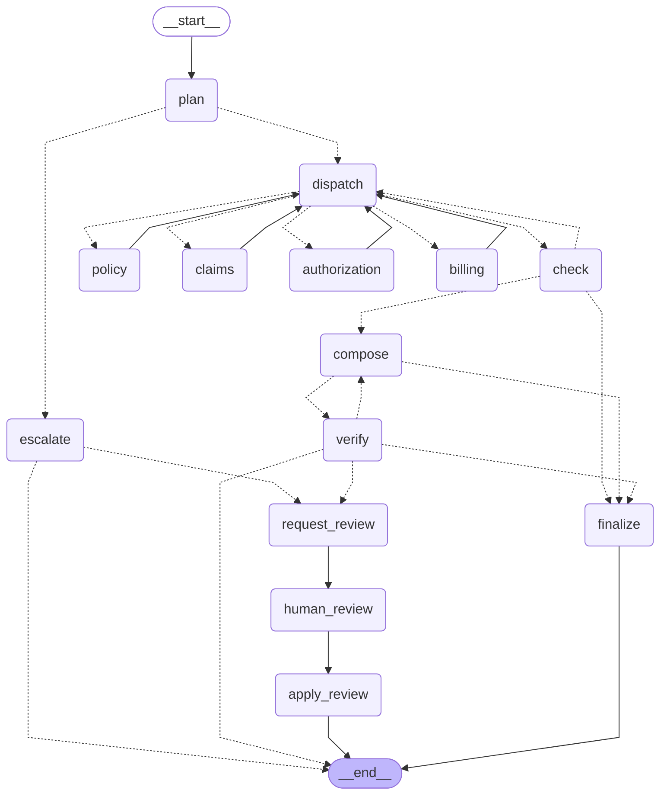

# CareAgents

A production-grade multi-agent assistant for health insurance members, orchestrated with
[LangGraph](https://github.com/langchain-ai/langgraph). It answers questions like *"Is my knee MRI covered,
do I need prior authorization, and how much will I pay?"* using specialist agents that call tools against
the system of record. Every number in an answer is checked against verified data before the member sees
it, and answers that can't be verified go to a staff review queue instead of being guessed.

This is a rebuild of [healthcare-multiagent-platform](https://github.com/njohnvipin/healthcare-multiagent-platform).
All data is fictional.

The workflow below is generated from the compiled graph (`GET /v1/admin/graph`, also in `docs/graph.mmd`),
so it always matches the code. Dashed edges are conditional.



## What changed from the prototype

| Prototype | CareAgents |
|---|---|
| Keyword router (`"pa"` matched inside `"pay"`) | LLM planner with structured output; word-boundary keyword router as fallback |
| Each agent: one retrieval + one LLM call | Tool-calling agents that choose their own tools, up to N rounds |
| Agents can't see each other | Shared case state; Billing runs after Claims/Authorization and sees their facts |
| Claims and billing as RAG over text files | Claims, eligibility, authorizations as SQL tables behind typed tools |
| Cost estimate assumed authorization was approved | Calculator returns both scenarios when authorization is missing; caps at out-of-pocket max |
| No checking of the final answer | Verifier rejects ungrounded amounts, recompose loop, LLM audit |
| Canned MRI answers when the LLM fails | Retries, circuit breakers, model fallback chain, honest degraded mode with real records |
| Ingestion duplicates chunks on every run | Idempotent, hash-based, background job |
| No auth, single hard-coded member | JWT roles, member isolation enforced in tools, audit log |
| Retired model (`llama-3.1-8b-instant`) | `openai/gpt-oss-20b` / `gpt-oss-120b` with automatic fallback |
| Sequential function calls | LangGraph `StateGraph`: parallel fan-out with `Send`, reducers, conditional routing |
| Nothing persists | Every step checkpointed in Postgres; cases pause for human review and resume on any pod |
| Answer arrives all at once | Server-sent events stream each step as it completes |

## Orchestration with LangGraph

The graph lives in `src/careagents/agents/graph.py`; `agents/runtime.py` runs it.

| Node | What it does |
|---|---|
| `plan` | Emergency regex, then the LLM planner (keyword fallback). Picks specialists or escalates. |
| `dispatch` | Fans out the next wave with `Send`. Agents whose dependencies are done run in parallel; Billing waits for Claims and Authorization. |
| `policy`, `claims`, `authorization`, `billing` | Tool-calling specialists. Each returns only its *delta* (new facts, evidence, usage). |
| `check` | Re-runs ungrounded or failed agents once (a second dispatch round); if models are down, runs each agent's core tools directly. |
| `compose` / `verify` | Strong-model draft, then deterministic grounding checks and an LLM audit. Loops back with the issues. |
| `request_review` → `human_review` → `apply_review` | Queues the case, pauses with `interrupt()`, resumes with the reviewer's decision. |
| `finalize`, `escalate` | Deterministic answers: verified records only, or fixed escalation messages. |

**State and reducers.** Parallel specialists never share mutable state. Each node rebuilds a `CaseState`
from the graph state, works on it, and returns a delta that reducers merge: facts as an append-only log,
evidence concatenated, per-agent runs merged by name, token usage summed. Replaying the fact log means
conflicts between parallel agents are still detected.

**Human in the loop.** When review is enabled, three situations pause the graph instead of auto-answering:
a draft that still fails verification, records that conflict, and complaints or legal escalations. The
member immediately gets their verified records plus a note that a specialist is reviewing. Staff approve,
edit or reject through the API; `Command(resume=...)` continues the same graph from its checkpoint, on
any pod, hours or days later. Side effects that must happen exactly once (queueing, audit) live in
`request_review`, before the interrupt, because a node that calls `interrupt()` re-executes from the top
when resumed.

**Checkpoint safety.** Checkpoints store four Pydantic state types, registered in an explicit serializer
allowlist (`checkpoint_serde`). LangGraph is moving to block unregistered types on load; without the
allowlist an upgrade would make every paused case impossible to resume. Tests run with
`LANGGRAPH_STRICT_MSGPACK=true` to prove it.

**Deadline and streaming.** The runtime runs the graph under the request deadline; on timeout it reads the
last checkpoint, so partial findings survive. For streaming, the graph runs in its own task and pushes
step events through a queue, so the deadline is enforced inside graph code, never across a yield to the
HTTP layer. A client disconnect cancels the case.

## Design decisions

**Facts come from tools, never from the model.** Tools read the system of record and write typed
facts (`claim.CLM-8892.status = denied`) into the case state. The composer may only use those facts and
retrieved plan text. The verifier extracts every `$` amount and `%` from the draft and rejects any that
don't appear in them. If two recompositions fail, the member gets a deterministic summary of their
records instead of an unverified answer.

**Records are queried, documents are searched.** RAG is right for plan documents and guidelines.
It is wrong for claims: similarity search can't guarantee the exact status or amount, and a shared
vector index can return another member's records. Records are SQL with `member_id` in every `WHERE`.

**Access control lives in code, not prompts.** `member_id` comes from the authenticated request and is
injected into every tool through `ToolContext`. Tool argument models forbid extra fields, so a model
(or a prompt injection) cannot pass a different member ID. Another member's claim returns `not_found`,
identical to a nonexistent one. Every member-data tool call is written to `audit_log` before it runs.

**Autonomy where judgment is needed, plain code where correctness is needed.** The models plan,
choose tools, and explain. Cost-sharing math (`tools/billing_calculator.py`), eligibility, and
authorization expiry are deterministic and unit-tested.

**Emergencies never wait for a model.** A regex check runs before any LLM call and returns a fixed
message pointing to 911 and 988. Planner-detected escalations also use fixed messages, not generated text.

## Request lifecycle

1. `POST /v1/chat` (or `/v1/chat/stream`): JWT verified, role checked, member resolved, rate limit applied.
2. A new graph thread is started with `thread_id = case_id`.
3. The graph runs as described above, checkpointing after every step.
4. The case ends `answered`, `escalated`, `degraded`, `timeout`, or `pending_review`.
5. The case is persisted to `case_runs` (upserted again when a review completes), metrics recorded, and a
   JSON log line written with hashed IDs.

Every response carries the facts and sources it used, per-agent status, token usage and `prompt_version`.

## Running it

**Quickest (no Docker, no API key needed to start):** in-memory data, lexical embeddings, auth off.
```bash
pip install -e ".[dev]"
cp .env.example .env          # add CA_LLM_API_KEY for real answers
make dev                      # http://localhost:8000/docs
curl -X POST localhost:8000/v1/chat -H 'Content-Type: application/json' \
  -d '{"question": "Is my knee MRI covered and how much will I pay?"}'
```
Without an API key, chat returns `degraded` answers built from records, which demonstrates the fallback path.

**Full stack (Postgres + pgvector, Redis, API, worker, real embeddings):**
```bash
cp .env.example .env          # set CA_LLM_API_KEY and CA_JWT_SECRET
docker compose up --build
TOKEN=$(docker compose exec api python -m careagents.devtools --role member --member-id SARAH-1001)
curl -X POST localhost:8000/v1/chat -H "Authorization: Bearer $TOKEN" -H 'Content-Type: application/json' \
  -d '{"question": "Why was my MRI claim denied and what will I owe?"}'
ADMIN=$(docker compose exec api python -m careagents.devtools --role admin)
curl -X POST localhost:8000/v1/admin/ingest -H "Authorization: Bearer $ADMIN"   # -> job_id
```
Demo members: `SARAH-1001` (MRI claim denied for missing authorization) and `JOHN-2002` (approved authorization).

## API

| Method | Path | Who | Purpose |
|---|---|---|---|
| POST | `/v1/chat` | member, staff | Ask a question. Staff must pass `member_id`; members may only access their own. |
| POST | `/v1/chat/stream` | member, staff | Same, as server-sent events: `started`, one `step` per node, then `result`. |
| GET | `/v1/cases/{case_id}` | member, staff | Current state of a case, e.g. one waiting for review. Members see only their own. |
| GET | `/v1/staff/reviews` | staff, admin | Review queue (metadata only, no question text). |
| GET | `/v1/staff/reviews/{case_id}` | staff, admin | Question, draft, facts and sources for one case. Audited. |
| POST | `/v1/staff/reviews/{case_id}` | staff, admin | `{"action": "approve" \| "edit" \| "reject", "answer": ...}` resumes the graph. 409 if not pending. |
| POST | `/v1/admin/ingest` | admin | Queue document ingestion (runs inline in dev without Redis). |
| GET | `/v1/admin/jobs/{id}` | admin | Ingestion job status and stats. |
| GET | `/v1/admin/status` | admin | Model chains and circuit-breaker states. |
| GET | `/v1/admin/graph` | admin | The live workflow as Mermaid source. |
| GET | `/livez`, `/readyz` | probes | Liveness; readiness checks Postgres and Redis. |
| GET | `/metrics/` | Prometheus | Scrape from inside the cluster only. |

OpenAPI docs are served in `dev`/`test` only.

## Configuration

All settings are environment variables with the `CA_` prefix (`src/careagents/config.py`). Lists are JSON.
In `staging`/`prod` the app **refuses to start** with unsafe settings: auth disabled, in-memory data,
lexical embeddings, no Redis, no API key, or no JWT key.

| Variable | Default | Notes |
|---|---|---|
| `CA_LLM_BASE_URL` | Groq | Any OpenAI-compatible endpoint |
| `CA_LLM_FAST_MODELS` | `["openai/gpt-oss-20b","openai/gpt-oss-120b"]` | Planner and specialists, tried in order |
| `CA_LLM_STRONG_MODELS` | `["openai/gpt-oss-120b","openai/gpt-oss-20b"]` | Composer and verifier |
| `CA_LLM_MAX_CONCURRENCY` | 32 | Per process. Fleet total = replicas x this |
| `CA_REQUEST_DEADLINE_S` | 45 | End-to-end budget per question |
| `CA_LLM_VERIFIER_ENABLED` | true | LLM audit after deterministic checks; costs one call |
| `CA_HUMAN_REVIEW_ENABLED` | true | Pause unverifiable, conflicting or complaint cases for staff review |
| `CA_DATA_BACKEND` | memory | `postgres` in any shared environment |
| `CA_EMBEDDINGS_BACKEND` | hashing | `sentence-transformers` outside dev |
| `CA_JWT_PUBLIC_KEY` / `CA_JWT_SECRET` | none | IdP public key (RS256) in prod; HS256 secret for dev |
| `CA_RATE_LIMIT_PER_MINUTE` | 20 | Per authenticated user |

## Deployment

`k8s/` contains: ConfigMap, Secret example, migration Job, API Deployment + Service + HPA + PDB,
worker Deployment and a NetworkPolicy. Containers run as non-root with a read-only root filesystem,
dropped capabilities and the embedding model baked into the image (no runtime downloads).

Rollout order: build image, run `migrate-job` (advisory-locked, safe to run concurrently), roll the
API and worker, then trigger ingestion if documents changed. `terminationGracePeriodSeconds` exceeds the
request deadline and a `preStop` delay lets the load balancer drain the pod, so rollouts don't drop
in-flight cases.

## Scaling

The API is stateless; scale it horizontally. Things to watch as traffic grows:

- **The LLM provider is the real bottleneck.** A question that needs all four specialists costs about 11 model calls (planner, two or three per specialist, composer, verifier); a single-specialist question about 5. Keep
  `replicas x CA_LLM_MAX_CONCURRENCY` under your provider rate limit, or replace the per-process
  semaphore with a Redis token bucket for a fleet-wide limit. Simple questions route to fewer agents
  and cost less; watch `ca_llm_tokens_total` per outcome.
- **Autoscale on load, not CPU.** Pods mostly wait on I/O, so CPU under-reports load. The HPA ships on
  CPU as a baseline; move to in-flight requests or p95 `ca_case_seconds` via KEDA or prometheus-adapter.
- **Database connections.** Each replica holds up to `CA_DB_POOL_MAX` connections. Put PgBouncer in
  transaction mode in front of Postgres before replicas x pool size approaches `max_connections`
  (prepared-statement caching is already disabled for this).
- **Vector search.** pgvector with HNSW is fine to millions of chunks. Search results are cached in
  Redis and invalidated by a version bump on ingestion.
- **Ingestion** runs on workers, which scale independently and hold a distributed lock.
- **Long requests.** If p95 latency gets uncomfortable, stream progress over SSE, or make chat an async
  job (enqueue, return `case_id`, poll or push) using the existing worker infrastructure.
- **Checkpoints** add a few writes per step and grow with every case. Delete threads for closed cases on
  your retention schedule (`checkpointer.adelete_thread(case_id)`), and size Postgres for it.
- **Paused cases cost nothing** while they wait: no process holds them, only rows in Postgres.
- **Circuit breakers** are per process. That is usually enough; a Redis-backed breaker is a drop-in
  replacement if you need fleet-wide state.

## Security and compliance

This handles protected health information (PHI). The code does its part; the rest is your
organization's responsibility. Have your compliance team review before go-live.

In the code:
- Member isolation enforced in tools and SQL; tested, including prompt-injection attempts.
- Append-only `audit_log` of who accessed which member's data, per request.
- No PHI in logs: member IDs are hashed, questions and bodies are never logged, validation errors
  don't echo input, traces exclude bodies. Responses are `Cache-Control: no-store`.
- Data minimization: tools don't send member names to the model.
- Retrieved documents and tool output are labelled as data, not instructions.
- Exceptions never reach the user; responses carry a `request_id` for support.
- Checkpoints contain PHI (questions, facts, drafts): same encryption, access control and retention as
  `case_runs`. Reviewer decisions are audited with the reviewer's identity.
- LangSmith tracing would send prompts and member data to a third party; leave it off unless your
  compliance team approves it or you self-host.

Your responsibility:
- A **Business Associate Agreement (BAA) with every LLM provider** that receives member data, or a
  self-hosted model. Check your provider's data retention and training policies.
- Encryption at rest and in transit (`sslmode=require`, `rediss://`), secrets from a secret manager.
- Retention policies for `case_runs` and `audit_log`; ship audit logs to write-once storage and grant
  the app role `INSERT` only on `audit_log`.
- IdP integration, MFA for staff and admin roles, and penetration testing.

## Observability

- **Metrics** (`/metrics/`): HTTP rate and latency by route; LLM calls by model and outcome, latency,
  tokens; agent runs by status; tool calls; case outcomes and end-to-end latency; verifier findings;
  rate-limit rejections.
- **Logs:** one JSON line per request and per case, correlated by `request_id`.
- **Traces:** `pip install ".[otel]"`, set `CA_OTEL_ENABLED=true` and `OTEL_EXPORTER_OTLP_ENDPOINT`.

Suggested alerts: `ca_cases_total{outcome="degraded"}` rate above baseline (model or data problem);
any circuit breaker open for more than 5 minutes; p95 `ca_case_seconds` near the deadline;
`ca_verifier_issues_total{kind="ungrounded_number"}` rising after a prompt or model change.

## Failure modes

| Failure | Behaviour |
|---|---|
| Model returns 429/5xx or times out | Retried with backoff and jitter, honouring `Retry-After` |
| Model decommissioned (400/404) | Not retried; next model in the chain; breaker opens |
| All models down | Specialists run their core tools directly; member gets their real records, `outcome=degraded` |
| Planner returns invalid JSON or unknown agents | Keyword router |
| One specialist fails | Retried once; others still answer; reply says that part is unavailable |
| Draft contains an unverified amount | Recomposed with the issue listed; then a deterministic answer |
| Deadline exceeded | Verified facts so far, `outcome=timeout` |
| Two sources disagree on a fact | `data_conflict` flag; the reply says a representative will confirm |
| Draft still unverifiable after retries | Paused for staff review; member sees verified records meanwhile |
| Reviewer acts hours later on another pod | Graph resumes from the Postgres checkpoint |
| Same review submitted twice | Second request gets 409; the graph only resumes from `human_review` |
| LangGraph tightens checkpoint deserialization | State types are allowlisted; tested in strict mode |
| Postgres or Redis down | `/readyz` fails and the pod leaves rotation |
| LLM provider down | `/readyz` stays healthy on purpose: degrade, don't take the service offline |

## Testing and evaluation

```bash
make test        # unit, API and LangGraph tests, no network (scripted fake LLM)
make up && make test-all   # adds integration tests against real Postgres/pgvector and Redis
make eval        # real model, 10 cases; exits non-zero below 90% pass
```
67 tests. The suite covers the LangGraph workflow (parallel fan-out order, reducers, review
approve/edit/reject, complaints, resuming on a different runtime instance, resuming after a full process
restart against Postgres, streaming order and deadlines, checkpoint type allowlist), member isolation, argument injection, auditing, the cost calculator (including
the out-of-pocket cap and authorization expiry), routing, dependency ordering, verifier rejection and
recompose, degraded mode, deadlines, escalation, rate limiting and readiness. The fake LLM identifies
callers by shape (tools offered, JSON mode, tier), so prompt edits don't break tests.

Run the evals with `--repeat 3` before changing prompts or models: they catch regressions in routing,
grounding, escalation and isolation that unit tests can't. Grow `eval/cases.json` from reviewed
`case_runs`, especially degraded ones. Prompts carry `PROMPT_VERSION`, which is returned with every answer.

## Project layout

```
src/careagents/
  agents/      graph.py (LangGraph workflow), runtime, supervisor, specialists, verifier, state, prompts
  tools/       tool framework (scoping, validation, audit), tools, cost calculator
  llm/         resilient OpenAI-compatible client
  data/        models, Postgres and in-memory backends, embeddings, search, cache, rate limiting
  ingestion/   markdown chunking and idempotent ingestion
  api/         FastAPI app, routes, auth dependencies
  auth/        JWT verification and roles
  migrations/  SQL migrations     seeds/  demo data
  worker.py  migrate.py  seed.py  devtools.py  container.py  config.py
tests/  eval/  k8s/  docs/  data/documents/
```

## Not included yet

- Integration with real payer systems: FHIR (Coverage, ExplanationOfBenefit, Claim), X12 270/271 for
  eligibility and 278 for prior authorization. The repository interfaces are where these plug in.
- A member-facing UI and conversation history (each question is currently independent).
- A staff UI for the review queue (the API is complete), and handoff into a CRM ticketing system.
- Binding each amount in an answer to the specific fact it cites (today amounts must exist in the
  verified facts, but aren't tied to which claim or scenario they belong to).
- Hybrid (keyword + vector) retrieval and re-ranking for large document sets.

## License

MIT
